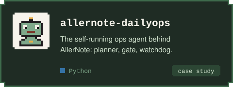
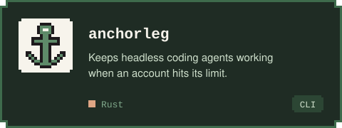
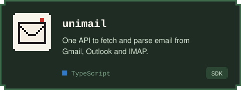
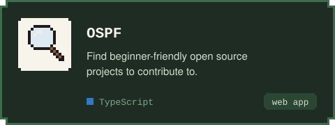
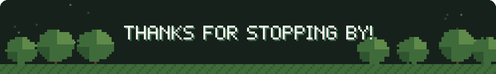

  

Right now that system is **[AllerNote](https://allernote.com)**, an allergen checker for people with contact allergies, which I build alone. Every morning an agent loop I built reads the product's signals, writes me a report, and ships small, verified code changes. I decide what gets built. The agents do most of the typing.

  
  

  
  

  

  

The pixel art is generated by <a href="assets/src/build.py">assets/src/build.py</a>. Edit a sprite grid, run it, and every image rebuilds.

<!-- Add once live: personal site, LinkedIn, writing. -->
